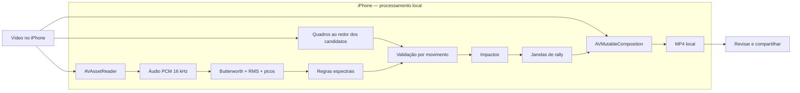

# Tennis Clips

Aplicativo para transformar uma gravação longa de tênis em um vídeo curto e
fluido das jogadas. A versão para iPhone está sendo construída em Swift e faz
todo o processamento no próprio aparelho — sem backend e sem upload do treino.

## Estrutura

```text
tennis-clips/
├── ios/         aplicativo SwiftUI e pipeline AVFoundation
└── research/    protótipo e experimentos em Python
```

## Arquitetura do produto



## iPhone

O cliente nativo está em [`ios`](ios/README.md). Ele já
contém:

- importação por PhotosPicker;
- detector Butterworth/RMS on-device portado da implementação SciPy;
- validação visual por movimento em três quadros;
- planejamento das janelas contextuais;
- montagem e exportação local;
- reprodução e compartilhamento do resultado;
- pacote de domínio com testes independentes do Xcode.

```bash
cd ios
xcodegen generate
open tennis-clips.xcodeproj
```

## Pesquisa em Python

O pipeline anterior e os analytics experimentais foram movidos integralmente
para [`research`](research/README.md):

```bash
uv sync --project research
uv run --project research tennis-clips make ~/Downloads/IMG_2842.MOV --mode rallies
```

As tags `v0.1.0`, `v0.2.0` e `v0.3.0` preservam os marcos anteriores. Vídeos,
outputs e caches são ignorados pelo Git para não publicar gravações pessoais.
