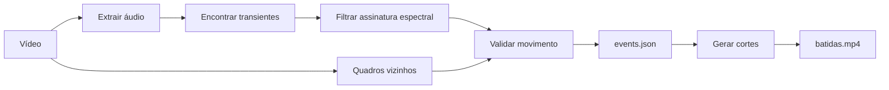

# Tennis Clips

Transforme uma gravação longa de treino em uma compilação vertical das suas
batidas. O projeto encontra impactos de raquete pelo áudio, confirma o movimento
do jogador no vídeo e usa FFmpeg para montar os cortes automaticamente.

> **Estado:** protótipo analítico v0.3.0. As versões anteriores estão preservadas
> nas tags `v0.1.0` e `v0.2.0`.

## O que já funciona

- detecção espectral de impactos sem modelo treinado;
- validação visual por movimento sincronizado;
- relatório JSON com tempo, confiança e métricas de cada evento;
- folha de contato para revisão rápida;
- renderização vertical em H.264/AAC;
- acompanhamento genérico do jogador por pose na camada analítica;
- classificação experimental de forehand e backhand;
- métricas cumulativas e overlay opcional durante o vídeo;
- manifesto analítico preparado para revisão humana.

## Como funciona



O detector combina energia em três bandas de frequência com movimento rápido
em torno do jogador. A abordagem mantém o pipeline explicável e ajustável, sem
exigir prematuramente um dataset rotulado.

O detector usa duas evidências:

1. um transiente de áudio forte com a distribuição de frequências típica da
   raquetada;
2. movimento sincronizado na região do jogador mais próximo da câmera.

O segundo estágio está calibrado para este primeiro vídeo, no qual o jogador
usa uma camisa amarela e a câmera fica parada atrás da linha de base.

## Requisitos

- [`uv`](https://docs.astral.sh/uv/)
- Python 3.12, instalado automaticamente pelo `uv` quando necessário
- `ffmpeg` e `ffprobe` disponíveis no `PATH`

O projeto e seu ambiente ficam nesta pasta. O `uv` cria `.venv` e usa o
`uv.lock` para reproduzir exatamente as dependências.

```bash
uv sync
```

## Uso

Analise o vídeo sem renderizar:

```bash
uv run tennis-clips analyze ~/Downloads/IMG_2842.MOV
```

Isso cria `output/events.json` com tempos e métricas e `output/review.jpg` com
uma folha visual para revisar as detecções.

Analise e crie a compilação:

```bash
uv run tennis-clips make ~/Downloads/IMG_2842.MOV
```

Crie uma versão contextual que mantém a preparação e o desfecho das jogadas:

```bash
uv run tennis-clips make ~/Downloads/IMG_2842.MOV \
  --reuse-events --mode rallies \
  --output output/jogadas-v1.mp4 --manifest output/jogadas-v1.json
```

O modo `hits` mantém a montagem curta da v0. O modo `rallies` usa cada batida
como âncora, expande a janela e une eventos próximos para preservar a troca de
bola. Cada renderização também cria `output/clips.json`, preparado para uma
futura revisão humana com os estados `unreviewed`, `accepted` e `rejected`.

## Vídeo analítico

Depois de criar o vídeo contextual, classifique os golpes e adicione o overlay:

```bash
uv run tennis-clips analytics ~/Downloads/IMG_2842.MOV
```

O comando cria:

- `output/jogadas-v3-analytics.mp4`, com as métricas durante o vídeo;
- `output/analytics-v3.json`, com métricas por golpe, rally e sessão;
- `output/analytics-v3-review.jpg`, para revisar as classificações rapidamente.

Por padrão, o jogador é destro. Para um jogador canhoto:

```bash
uv run tennis-clips analytics ~/Downloads/treino.MOV --handedness left
```

O modelo de pose, com aproximadamente 9 MB, é baixado no primeiro uso para
`.tennis-clips-models/` e não é versionado.

O resultado padrão é `output/batidas.mp4`. Depois da primeira análise, é
possível editar novamente sem recalcular os eventos:

```bash
uv run tennis-clips make ~/Downloads/IMG_2842.MOV --reuse-events
```

## Calibração

```bash
# Menos falsos positivos (mais exigente)
uv run tennis-clips analyze ~/Downloads/IMG_2842.MOV \
  --amplitude-percentile 99 --min-motion 0.10

# Cortes um pouco mais longos e saída em 1080x1920
uv run tennis-clips make ~/Downloads/IMG_2842.MOV \
  --pre-roll 0.8 --post-roll 1.0 --height 1920
```

Valores menores de `--amplitude-percentile` e `--min-motion` aumentam a
sensibilidade; valores maiores priorizam precisão.

## Limitações atuais

- o detector inicial de impactos ainda usa a camisa amarela como pista visual;
  a nova camada analítica por pose já é independente dessa cor;
- o modo contextual ainda usa margens temporais, sem classificar explicitamente
  a resposta do adversário ou o fim da jogada;
- quiques e movimentos rápidos podem produzir falsos positivos;
- forehand/backhand são heurísticas de pose e devem ser revisados antes de serem
  tratados como verdade de treino;
- saque, voleio e smash só aparecem quando a confiança visual é suficiente;
- ainda não há tracking de bola, velocidade, direção ou profundidade;
- `movement_index` e `fatigue_signal` são proxies experimentais, não metros nem
  avaliação fisiológica.

## Próximas iterações

- remover a pista da camisa amarela também da detecção inicial de impactos;
- regras distintas para raquetada próxima, distante e quique;
- revisão humana no estilo aceitar/rejeitar;
- uso das revisões como futuro dataset rotulado.
- calibração da quadra e tracking da bola para velocidade, direção e profundidade;
- tempo de recuperação e distância percorrida em unidades reais.

Vídeos, caches e outputs são ignorados pelo Git. Isso mantém o repositório leve
e evita publicar gravações pessoais por acidente.
