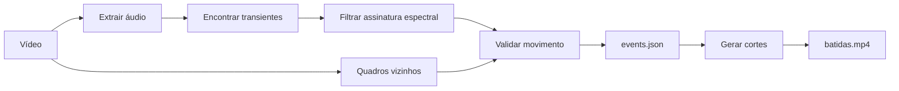

# Tennis Clips

Transforme uma gravação longa de treino em uma compilação vertical das suas
batidas. O projeto encontra impactos de raquete pelo áudio, confirma o movimento
do jogador no vídeo e usa FFmpeg para montar os cortes automaticamente.

> **Estado:** protótipo v0.1.0, calibrado a partir de um treino de 10 minutos
> gravado com iPhone, câmera fixa atrás da linha de base.

## O que já funciona

- detecção espectral de impactos sem modelo treinado;
- validação visual por movimento sincronizado;
- relatório JSON com tempo, confiança e métricas de cada evento;
- folha de contato para revisão rápida;
- renderização vertical em H.264/AAC.

## Como funciona



O detector combina energia em três bandas de frequência com movimento rápido
em torno do jogador. A abordagem mantém o pipeline explicável e ajustável, sem
exigir prematuramente um dataset rotulado.

O detector usa duas evidências:

1. um transiente de áudio forte com a distribuição de frequências típica da
   raquetada;
2. movimento sincronizado na região do jogador mais próximo da câmera.

O segundo estágio está calibrado para este primeiro vídeo, no qual o jogador
usa uma camisa amarela e a câmera fica parada atrás da linha de base.

## Requisitos

- [`uv`](https://docs.astral.sh/uv/)
- Python 3.12, instalado automaticamente pelo `uv` quando necessário
- `ffmpeg` e `ffprobe` disponíveis no `PATH`

O projeto e seu ambiente ficam nesta pasta. O `uv` cria `.venv` e usa o
`uv.lock` para reproduzir exatamente as dependências.

```bash
uv sync
```

## Uso

Analise o vídeo sem renderizar:

```bash
uv run tennis-clips analyze ~/Downloads/IMG_2842.MOV
```

Isso cria `output/events.json` com tempos e métricas e `output/review.jpg` com
uma folha visual para revisar as detecções.

Analise e crie a compilação:

```bash
uv run tennis-clips make ~/Downloads/IMG_2842.MOV
```

O resultado padrão é `output/batidas.mp4`. Depois da primeira análise, é
possível editar novamente sem recalcular os eventos:

```bash
uv run tennis-clips make ~/Downloads/IMG_2842.MOV --reuse-events
```

## Calibração

```bash
# Menos falsos positivos (mais exigente)
uv run tennis-clips analyze ~/Downloads/IMG_2842.MOV \
  --amplitude-percentile 99 --min-motion 0.10

# Cortes um pouco mais longos e saída em 1080x1920
uv run tennis-clips make ~/Downloads/IMG_2842.MOV \
  --pre-roll 0.8 --post-roll 1.0 --height 1920
```

Valores menores de `--amplitude-percentile` e `--min-motion` aumentam a
sensibilidade; valores maiores priorizam precisão.

## Limitações da v0

- a região do jogador ainda usa a cor da camisa como pista;
- cada impacto gera um corte curto, sem acompanhar o desfecho da jogada;
- quiques e movimentos rápidos podem produzir falsos positivos;
- ainda não há rastreamento explícito da pessoa ou da bola.

## Próximas iterações

- modo contextual que agrupa impactos em jogadas completas;
- identificação genérica do jogador com câmera fixa;
- regras distintas para raquetada próxima, distante e quique;
- revisão humana no estilo aceitar/rejeitar;
- uso das revisões como futuro dataset rotulado.

Vídeos, caches e outputs são ignorados pelo Git. Isso mantém o repositório leve
e evita publicar gravações pessoais por acidente.
