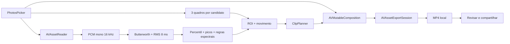

# Tennis Clips para iPhone

Aplicativo nativo SwiftUI que executa todo o pipeline no próprio iPhone. Não há
backend, upload nem dependência do projeto Python em runtime.

## Pipeline on-device



O detector nativo é um porte direto da versão Python validada. Ele usa os mesmos
Butterworth de ordem 4 e coeficientes SOS, `sosfiltfilt`, envelope RMS de 8 ms a
200 Hz, percentil 98,5, distância/proeminência dos picos e razões das três
bandas. Cada candidato passa ainda pela mesma validação visual em três quadros:
ROI do jogador, cinza, Gaussian 5×5, diferença absoluta e limiar de movimento.

O `ClipPlanner` transforma os eventos em janelas de rally de 1,2 s antes e 2,6 s
depois, unidas quando se sobrepõem.

## Paridade com o protótipo

O pacote `core/` contém testes numéricos e dois executáveis usados pelos scripts
de paridade. No vídeo de referência, o estágio de áudio produz os mesmos 102
candidatos, nos mesmos timestamps (diferença máxima de 0 ms):

```bash
uv run --project research python research/scripts/check_ios_signal_parity.py \
  .tennis-clips-cache/IMG_2842-mono-16000.wav
```

A etapa visual pode ser auditada candidato a candidato:

```bash
uv run --project research python research/scripts/check_ios_motion_parity.py \
  ~/Downloads/IMG_2842.MOV \
  .tennis-clips-cache/IMG_2842-mono-16000.wav
```

AVFoundation e FFmpeg podem decodificar alguns pixels de forma ligeiramente
diferente. O harness mostra essas diferenças sem aplicar parâmetros escondidos
por plataforma. Igualdade de pixels exigiria usar o mesmo decoder nos dois
runtimes; isso não altera a equivalência das regras do detector.

## Abrir

O projeto é gerado por XcodeGen:

```bash
cd ios
xcodegen generate
open tennis-clips.xcodeproj
```

Requisitos:

- Xcode completo com um runtime de iOS Simulator;
- iOS 17 ou mais recente;
- assinatura Apple configurada apenas para instalar em um iPhone físico.

Se as ferramentas de linha de comando ainda apontarem para o pacote isolado,
ative o Xcode completo e conclua sua preparação inicial:

```bash
sudo xcode-select --switch /Applications/Xcode.app/Contents/Developer
sudo xcodebuild -runFirstLaunch
```

O app foi validado no Xcode 26.6 com um iPhone 17 Pro no iOS Simulator 26.5.

O pacote `core/` contém modelos e a lógica pura de montagem dos rallies. Ele pode
ser testado sem Xcode:

```bash
swift test --package-path ios/core
```

## Estado da implementação

- importação de vídeo com PhotosPicker;
- detector de áudio portado com paridade numérica ao SciPy;
- validação visual por movimento no aparelho;
- criação e união das janelas de rally;
- montagem e exportação local com AVFoundation;
- reprodução, resumo e compartilhamento do resultado;
- sem rede e sem backend.
