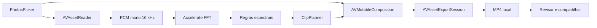

# Tennis Clips para iPhone

Aplicativo nativo SwiftUI que executa todo o pipeline no próprio iPhone. Não há
backend, upload nem dependência do projeto Python em runtime.

## Pipeline on-device



O detector nativo replica o princípio da versão Python validada: procura
transientes fortes e filtra pela distribuição de energia em bandas. Os eventos
viram janelas de rally de 1,2 s antes e 2,6 s depois, unidas quando se sobrepõem.

## Abrir

O projeto é gerado por XcodeGen:

```bash
cd ios/tennis-clips
xcodegen generate
open tennis-clips.xcodeproj
```

Requisitos:

- Xcode completo com um runtime de iOS Simulator;
- iOS 17 ou mais recente;
- assinatura Apple configurada apenas para instalar em um iPhone físico.

Neste Mac, o Xcode atual da App Store exige uma versão mais nova do macOS. O
Xcode 16.4 pode ser instalado pelo utilitário `xcodes`, já preparado na máquina:

```bash
xcodes install 16.4 \
  --directory ~/Applications \
  --no-superuser \
  --experimental-unxip
```

Esse comando pede a autenticação do Apple ID diretamente no terminal. Depois da
instalação, aponte `DEVELOPER_DIR` para o diretório `Contents/Developer` do Xcode
instalado e rode o projeto sem alterar globalmente o `xcode-select`.

O pacote `core/` contém modelos e a lógica pura de montagem dos rallies. Ele pode
ser testado sem Xcode:

```bash
swift test --package-path ios/tennis-clips/core
```

## Estado da implementação

- importação de vídeo com PhotosPicker;
- leitura e análise espectral do áudio no aparelho;
- criação e união das janelas de rally;
- montagem e exportação local com AVFoundation;
- reprodução, resumo e compartilhamento do resultado;
- sem rede e sem backend.

A validação visual por movimento ainda é o próximo estágio do port para Swift.
Até ela entrar, os filtros espectrais são a única evidência de impacto no app.
